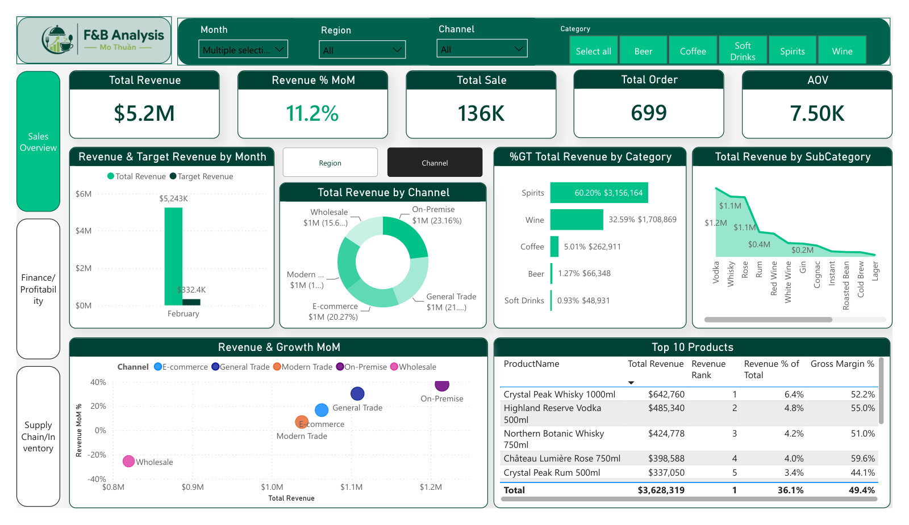
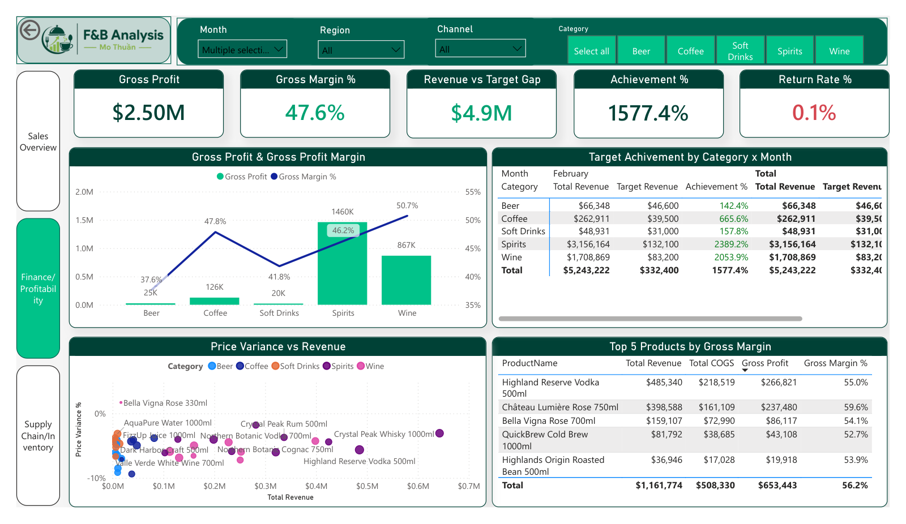
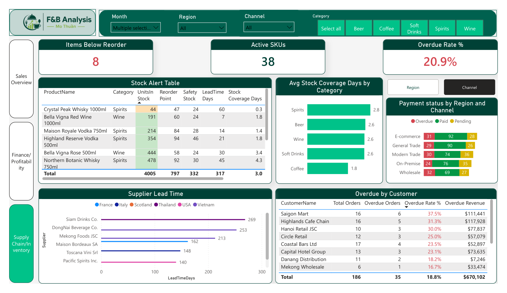

# F&B Distribution — Sales, Profitability & Supply Chain (Power BI)

A three-page Power BI report for a beverage distributor operating across the North, Central and
South regions of Vietnam. One model serves three audiences: **sales**, **finance** and
**supply chain / inventory**.

| | |
|---|---|
| **Data** | 1 product master (40 SKUs + monthly targets) and 2 monthly transaction exports (~1,350 orders, Jan–Feb 2025) |
| **Tools** | Power BI Desktop · Power Query (M) · DAX · star schema |
| **Files** | [`dashboard/fnb-distribution-dashboard.pbix`](dashboard/fnb-distribution-dashboard.pbix) · [PDF export](dashboard/fnb-distribution-dashboard.pdf) · [one-page analysis note](docs/fnb-distribution-one-page-report.pdf) |

## Business questions answered

| Question | Answer |
|---|---|
| Where does revenue come from? | **Spirits 59.7%** and **Wine 32.9%** of $9.96M — 92.6% combined. Channels are evenly split (19–21% each). |
| Which products make money — and which only look big? | Crystal Peak Whisky 1000ml leads gross profit ($579K, 51% margin). Two high-revenue SKUs sell below list price with **35–39% margins**. |
| What drove the month-on-month change? | Revenue **+11.2%** (Jan → Feb): Spirits +13.1%, a channel shift (On-Premise +38%, Wholesale −25.5%) and February promotions (340 promo orders, $2.3M). |
| Are targets being met? | Achievement is ~1,500% for every category — a **data issue, not a performance story**: targets are on a different scale than revenue. Flagged for the operations team to confirm the target unit. |
| What needs restocking now? | **8 active SKUs** are below reorder point, all with stock cover shorter than their lead time — including the #1 profit product (44 units, 60-day lead time). |
| Where is cash at risk? | **20.6%** of orders ($1.27M) are overdue; four key accounts sit above 27%. Proposed tiered payment terms by overdue rate. |

## Data preparation (Power Query)

- **Schema alignment:** the two monthly exports used different column names, date formats and discount formats (`"15%"` text vs `0.15`). Both were standardised and appended into one fact table.
- **Cleaning:** trimmed and upper-cased product IDs, mapped 12 inconsistent region spellings to 3 regions, treated negative quantities as returns, and removed 7 exact duplicate orders.
- **Orphans:** 17 orders reference product IDs missing from the master (~1.3%). Kept for audit, excluded from revenue and cost.
- **Model:** star schema (sales fact; product, date and target dimensions). Targets sit at Category × Month grain and are applied with `TREATAS` instead of a physical relationship.

## Report pages

1. **Sales overview** — revenue, orders, AOV, category share, month-on-month change, revenue vs target, sub-category ranking.
2. **Finance / profitability** — gross profit and margin by category, target achievement by category × month, price variance vs revenue, top products by margin.
3. **Supply chain / inventory** — SKUs below reorder point, stock coverage days by category, payment status by region and channel, overdue rate by customer.

| Finance / profitability | Supply chain / inventory |
|---|---|
|  |  |

## Run it yourself

1. Open `dashboard/fnb-distribution-dashboard.pbix` in Power BI Desktop.
2. **Transform data → Data source settings → Change Source** and point the three files to your local `data/` folder.
3. **Refresh**.

The dataset is a sample prepared for this case study; all values are in USD.
